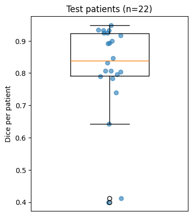
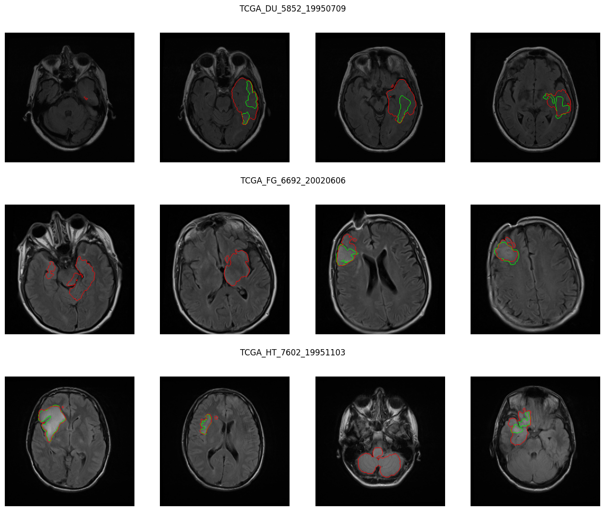

# 🧠 Brain Tumor Segmentation (LGG MRI)

[](https://www.python.org/downloads/)
[](https://pytorch.org/)
[](LICENSE)
[](https://gradio.app)

> **Automated semantic segmentation of low-grade glioma (LGG) brain tumors from multimodal MRI slices using deep U-Net architectures, patient-stratified validation, bootstrap confidence intervals, and empirical failure analysis.**

---

## 📌 Overview & Demo

Detecting and outlining tumor boundaries on brain MRI scans is vital for surgical planning and radiation therapy. This repository provides an end-to-end deep learning pipeline trained on the **LGG MRI Segmentation Dataset** (The Cancer Genome Atlas / Mateusz Buda et al.). It features strict patient-grouped validation to prevent data leakage, a hybrid Dice + Binary Cross-Entropy loss function, statistical bootstrap evaluation, and an interactive Gradio web application for real-time inference.


---

## 📊 Benchmark Results

Evaluated across **22 held-out test patients, Dice computed per patient volume** (slices containing both tumor and healthy tissue) under a reproducible fixed seed (`SEED = 42`):

| Method / Model | Mean Dice Score ↑ | 95% Bootstrap CI | Median Dice Score ↑ | False Alarms on Tumor-Free Slices ↓ | Total Empty Slices |
| :--- | :---: | :---: | :---: | :---: | :---: |
| **FLAIR Threshold Baseline ($k=1.25$)** | 0.328 | — | 0.319 | 413 (85.5%) | 483 |
| **U-Net (ResNet-34 Encoder)** | **0.812** | **[0.746, 0.868]** | **0.839** | **23 (4.8%)** | 483 |

*Raw benchmarking data is preserved in [`results.csv`](results.csv).*

<p align="center">
  
  <br>
  <em>Per-patient test Dice score distribution across all 22 held-out test patients (Mean: 0.812, Median: 0.839, 95% Bootstrap CI: [0.746, 0.868]).</em>
</p>

---

## 🔬 Dataset & Modality Overview

The model is trained on 3,929 brain MRI slices across 110 patients from TCGA. Each sample includes multimodal sequences (pre-contrast T1, FLAIR, post-contrast T1) and expert-annotated tumor masks:

<p align="center">
  
</p>

---

## 📁 Repository Structure

```text
├── assets/
│   ├── dataset_overview.png              # Multimodal MRI sequence & mask exploration grid
│   ├── demo.png                          # U-Net prediction demo banner with red outline
│   ├── demo_slice.png                    # Sample raw MRI slice
│   ├── dice_boxplot.png                  # Per-patient Dice distribution & 95% bootstrap CI
│   ├── failure_cases.png                 # Verified failure mode analysis on worst-performing test cases
│   └── tumor_outline.png                 # Standalone raw slice with tumor boundary overlay
├── samples/
│   ├── sample_patient_01_tumor.png       # Real patient slice with low-grade glioma
│   ├── sample_patient_02.png             # Real patient slice with small lesion
│   └── sample_patient_03_tcga.png        # Real test patient slice (TCGA-CS-4941)
├── .gitignore                            # Clean ignore list (weights, raw datasets, cache)
├── LICENSE                               # MIT Open-Source License
├── README.md                             # Project documentation, results, and quickstart
├── app.py                                # Gradio web app & Hugging Face Spaces entry point
├── brain_tumor_notebook_v4.ipynb         # End-to-end pipeline (reproducible seed, training, CI, failure analysis, post-processing)
├── requirements.txt                      # Pinned core dependencies
└── results.csv                           # Benchmark evaluation metrics
```

---

## 🚀 Quickstart Guide

### 1. Environment Setup

Clone the repository and install dependencies:

```bash
git clone https://github.com/simply-shanta-4/brain-tumor-segmentation.git
cd "brain-tumor-segmentation"

# Create and activate a virtual environment
python -m venv venv
# On Windows:
venv\Scripts\activate
# On Linux/macOS:
source venv/bin/activate

# Install dependencies
pip install -r requirements.txt
```

### 2. Download Model Weights (`best_unet.pt`)

`app.py` requires `best_unet.pt` in the project root to run inference. Download the weights and place them next to `app.py`:

```bash
# Download from your Hugging Face model repository or Space:
curl -L -o best_unet.pt "https://huggingface.co/simply-shanta-4/brain-tumor-segmentation/resolve/main/best_unet.pt"
```

*(Alternatively, train the model yourself using `brain_tumor_notebook_v4.ipynb` to generate `best_unet.pt`.)*

### 3. Launch the Interactive Gradio Web Demo

Run the Gradio application locally (also ready for deployment to **Hugging Face Spaces**):

```bash
python app.py
```

Open your browser at `http://localhost:7860` to upload an MRI slice and inspect the red tumor contour overlay.

### 4. Run the Full Training & Evaluation Pipeline

Launch Jupyter or execute the complete notebook pipeline:

```bash
jupyter notebook brain_tumor_notebook_v4.ipynb
```

The pipeline implements:
- **Reproducible Pipeline**: Fixed random seed (`SEED = 42`) for deterministic dataset partitioning and weight initialization.
- **Data Ingestion**: Exploration of 3,929 FLAIR/multimodal slices across 110 patients from TCGA-LGG.
- **Patient-Level Splitting**: `GroupShuffleSplit` (74 train / 14 val / 22 test patients) ensuring slices from the same patient never leak across splits.
- **FLAIR Baseline**: Statistical intensity thresholding with morphological erosion ($k=1.25$).
- **U-Net Model Training**: ResNet-34 backbone with mixed precision (`torch.amp`), Cosine Annealing learning rate schedule, and combined Dice + BCE loss.
- **Bootstrap Statistical Evaluation**: 1,000-iteration bootstrap confidence intervals and per-patient boxplot generation (`dice_boxplot.png`).
- **Empirical Failure Analysis**: Systematic qualitative and quantitative inspection of the worst-performing patient test volumes.
- **Post-Processing Optimization**: Connected component filtering (`min_area=200`) tuned on validation splits to suppress spurious false alarms on tumor-free slices.

---

## ⚠️ Limitations & Clinical Disclaimer

### 1. Verified Failure Mode: Boundary Leaking & Over-Segmentation
Earlier hypotheses speculated that poor test scores stemmed from small, faint, or missed lesions. However, empirical failure analysis in `brain_tumor_notebook_v4.ipynb` across the lowest-scoring test cases identified the actual mechanism: **substantial over-segmentation and false boundary expansion into surrounding hyperintense tissue (edema / diffuse FLAIR signal)**.

<p align="center">
  
  <br>
  <em>Failure analysis on the 3 worst test patients: Ground truth contour in <b>green</b>, model prediction in <b>red</b>. In all three cases, the model captures the tumor core but expands extensively into surrounding FLAIR-hyperintense tissue.</em>
</p>

Quantitative breakdown of the 3 lowest-scoring test patient volumes:
- **`TCGA_DU_5852_19950709` (Dice: 0.40)**: Ground truth had 5,083 tumor pixels across 8 slices; the model predicted 19,155 pixels (**3.77× over-prediction**).
- **`TCGA_FG_6692_20020606` (Dice: 0.41)**: Ground truth had 7,115 tumor pixels across 7 slices; the model predicted 21,969 pixels (**3.09× over-prediction**).
- **`TCGA_HT_7602_19951103` (Dice: 0.64)**: Ground truth had 6,946 tumor pixels across 7 slices; the model predicted 13,607 pixels (**1.96× over-prediction**).

In each instance, non-enhancing peritumoral edema or diffuse hyperintensity shares intensity profiles with the tumor core in FLAIR, causing the 2D U-Net to bleed across boundaries.

### 2. Per-Patient Score Variance & Confidence Intervals
While the median patient volume Dice score is **0.839**, volume-level scores range from **0.400** to **0.950+**. 
Bootstrap resampling (1,000 iterations) indicates a **95% confidence interval of [0.746, 0.868]** around the mean Dice of **0.812** ($n=22$ patients). The long lower tail highlights sensitivity to patient-specific acquisition contrast and tumor margin conspicuity.

### 3. 2D Slice Approximation vs. 3D Volumetric Continuity
Inference is conducted slice-by-slice in the 2D axial plane ($256 \times 256 \times 3$). The network does not exploit through-plane (z-axis) spatial continuity. As a result, marginal slices near the superior and inferior tumor poles exhibit higher boundary ambiguity and lack 3D spatial smoothness constraints that a 3D volumetric model (e.g., 3D nnU-Net) would enforce.

### 4. Single-Cohort Dataset & Generalization Constraints
All 110 patients are drawn from a single public collection (**TCGA-LGG**). The model has not been evaluated on external multi-center cohorts with varying scanner manufacturers (Siemens, Philips, GE), variable field strengths (1.5T vs. 3T), or different acquisition parameter protocols. Performance may degrade on out-of-distribution scanner data or on high-grade gliomas (HGG/glioblastoma).

### 5. False Alarms on Tumor-Free Slices & Post-Processing
On healthy brain slices with no tumor, the raw model produced false positive detections on **23 out of 483 slices (4.8%)**. Tuning morphological area filtering (`remove_small_objects(min_area=200)`) on validation data reduced validation false alarms from 5/269 to 1/269. However, post-processing cannot resolve large contiguous false positives that attach directly to the main lesion boundary.

### 6. Clinical Decision Support Disclaimer
This repository is developed strictly for **academic research, educational demonstrations, and benchmark reproducibility**. It is **not** an FDA- or CE-cleared medical device and must never be utilized for primary medical diagnosis, clinical triage, surgical margin resection, or radiotherapy treatment planning.

---

## 📜 License

This project is licensed under the terms of the [MIT License](LICENSE).
