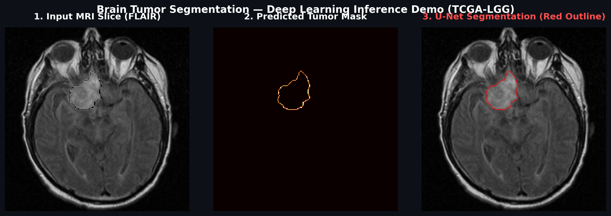
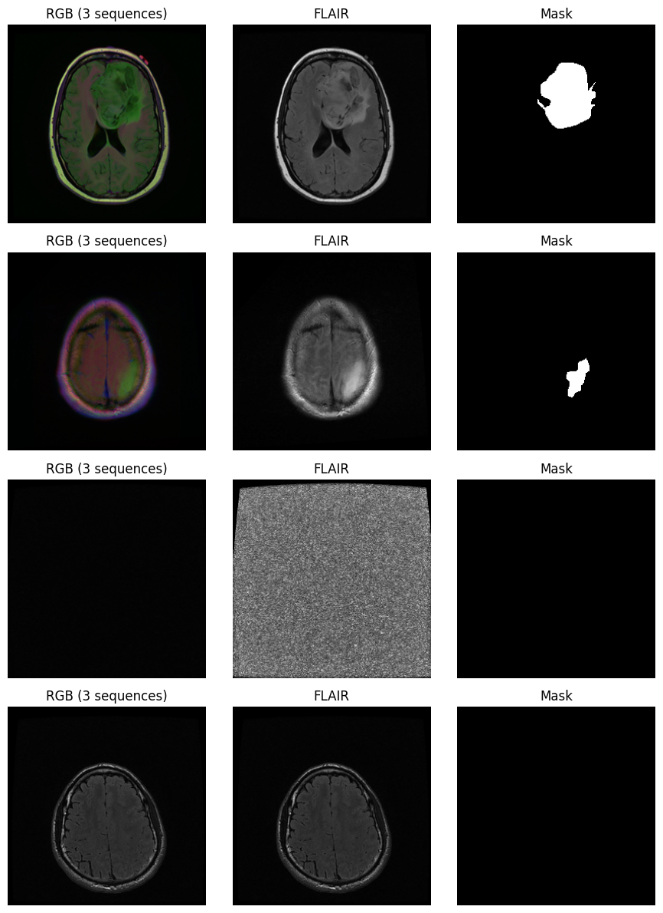

# 🧠 Brain Tumor Segmentation (LGG MRI)

[](https://www.python.org/downloads/)
[](https://pytorch.org/)
[](LICENSE)
[](https://gradio.app)

> **Automated semantic segmentation of low-grade glioma (LGG) brain tumors from multimodal MRI slices using deep U-Net architectures and patient-stratified validation.**

---

## 📌 Overview & Demo

Detecting and outlining tumor boundaries on brain MRI scans is vital for surgical planning and radiation therapy. This repository provides an end-to-end deep learning pipeline trained on the **LGG MRI Segmentation Dataset** (The Cancer Genome Atlas / Mateusz Buda et al.). It features strict patient-grouped validation to prevent data leakage, a hybrid Dice + Binary Cross-Entropy loss function, and an interactive Gradio web application for real-time inference.



---

## 📊 Benchmark Results

Evaluated across held-out test patients (slices containing both tumor and healthy tissue):

| Method / Model | Mean Dice Score ↑ | Median Dice Score ↑ | False Alarms on Tumor-Free Slices ↓ | Total Empty Slices |
| :--- | :---: | :---: | :---: | :---: |
| **FLAIR Threshold Baseline ($k=1.25$)** | 0.328 | 0.319 | 413 (85.5%) | 483 |
| **U-Net (ResNet-34 Encoder)** | **0.827** | **0.870** | **10 (2.1%)** | 483 |

*Raw benchmarking data is preserved in [`results.csv`](results.csv).*

---

## 🔬 Dataset & Modality Overview

The model is trained on 3,929 brain MRI slices across 110 patients from TCGA. Each sample includes multimodal sequences (pre-contrast T1, FLAIR, post-contrast T1) and expert-annotated tumor masks:

<p align="center">
  
</p>

---

## 📁 Repository Structure

```text
├── assets/
│   ├── demo.png                          # U-Net prediction demo banner with red outline
│   ├── dataset_overview.png              # Multimodal MRI sequence & mask exploration grid
│   └── tumor_outline.png                 # Standalone raw slice with tumor boundary overlay
├── samples/
│   ├── sample_patient_01_tumor.png       # Real patient slice with low-grade glioma
│   ├── sample_patient_02.png             # Real patient slice with small lesion
│   └── sample_patient_03_tcga.png        # Real test patient slice (TCGA-CS-4941)
├── .gitignore                            # Clean ignore list (weights, raw datasets, cache)
├── LICENSE                               # MIT Open-Source License
├── README.md                             # Project documentation, results, and quickstart
├── app.py                                # Gradio web app & Hugging Face Spaces entry point
├── notebook.ipynb                        # Full pipeline (data prep, split, training, eval)
├── requirements.txt                      # Pinned core dependencies
└── results.csv                           # Benchmark evaluation metrics
```

---

## 🚀 Quickstart Guide

### 1. Environment Setup

Clone the repository and install the required dependencies:

```bash
git clone https://github.com/your-username/brain-tumor-segmentation.git
cd "brain-tumor-segmentation"

# Create and activate a virtual environment
python -m venv venv
# On Windows:
venv\Scripts\activate
# On Linux/macOS:
source venv/bin/activate

# Install dependencies
pip install -r requirements.txt
```

### 2. Launch the Interactive Gradio Web Demo

Run the Gradio application locally (also ready for deployment to **Hugging Face Spaces**):

```bash
python app.py
```

Open your browser at `http://localhost:7860` to upload any brain MRI slice and inspect the red tumor contour overlay.

### 3. Run the Training Pipeline

Launch Jupyter or execute the complete notebook pipeline:

```bash
jupyter notebook notebook.ipynb
```

The pipeline implements:
- **Data Ingestion**: Exploration of 3,929 FLAIR/multimodal slices across 110 patients.
- **Patient-Level Splitting**: `GroupShuffleSplit` (80/20 train-val/test, then 85/15 train/val) ensuring slices from the same patient never appear across splits.
- **FLAIR Baseline**: Statistical intensity thresholding with morphological erosion.
- **U-Net Model Training**: ResNet-34 backbone with mixed precision (`torch.amp`), Cosine Annealing learning rate schedule, and combined Dice + BCE loss.
- **Per-Patient Evaluation**: Complete quantitative validation and false alarm profiling.

---

## ⚠️ Limitations & Clinical Disclaimer

- **Research Prototype Only**: This software is developed solely for academic research, education, and benchmark evaluation. It is **not** an FDA- or CE-cleared medical device and must not be used for primary clinical diagnostics or treatment planning.
- **2D Slice Approximation**: Slices are segmented in 2D plane; it does not model the full 3D volumetric continuity of 3D MRI scans (e.g. volumetric NIfTI volumes).
- **Scanner & Sequence Variability**: Performance is benchmarked on the LGG dataset. Scans acquired with different field strengths (e.g., 1.5T vs. 3.0T) or non-standard FLAIR weighting may require domain adaptation or fine-tuning.

---

## 📜 License

This project is licensed under the terms of the [MIT License](LICENSE).
